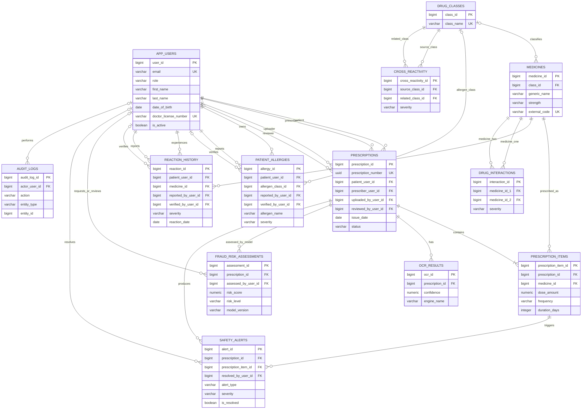

# MediTrace ER Diagram

## How to explain it in the viva

- **`app_users` is the central identity table.** Roles decide whether a user acts as a patient, doctor, pharmacist, administrator, or auditor; duplicated account tables are avoided.
- **A prescription links one patient, one prescriber, and an uploader.** It can later be reviewed by a pharmacist or admin.
- **`prescription_items` resolves the many-to-many relationship** between prescriptions and medicines, while storing dose and frequency only once per prescribed medicine.
- **Safety data is separate from the prescription.** Allergies, prior reactions, known drug interactions, and class cross-reactivity generate `safety_alerts` for a specific prescription item.
- **AI/ML results are advisory.** `fraud_risk_assessi ments` stores the score, model version, and explanation, but a pharmacist/admin makes the final decision.
- **`audit_logs` records accountable actions** such as viewing, updating, and reviewing records.
